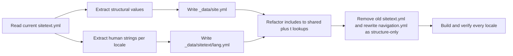

# Plan: Separate translatable text from shared config

## Goals

1. `_data/site.yml` holds only language-independent structure: section IDs, nav order, icons, images, URLs, alignment, layout flags.
2. `_data/sitetext/<lang>.yml` holds only human-readable, translatable strings, keyed so templates can join them to the shared structure.
3. Every include renders through one code path instead of duplicating a locale branch.
4. Section IDs, nav order, and icons become impossible to break from a translation file.

## Target data model

### `_data/site.yml`

```yaml
default_locale: en

sections:
  services: servicesSection
  portfolio: portfolioSection
  timeline: timelineSection
  about: aboutSection
  team: teamSection
  contact: contactSection
  clients: clientsSection

header:
  button:
    target: services

services:
  items:
    - key: ecommerce
      icon: fas fa-shopping-cart
    - key: responsive
      icon: fas fa-laptop
    - key: markdown
      icon: fab fa-markdown

timeline:
  start_align: left
  events:
    - key: beginnings
      image: assets/img/timeline/1.jpg
    - key: agency-born
      image: assets/img/timeline/2.jpg
    - key: jekyll-theme
      image: assets/img/timeline/3.jpg
    - key: your-story
      image: assets/img/timeline/4.jpg
      align: right

team:
  people:
    - key: kay-garland
      image: assets/img/team/500x500.jpg
    - key: larry-parker
      image: assets/img/team/2.jpg
    - key: diana-perterson
      image: assets/img/team/500x500.jpg

clients:
  max_height: 100px
  horizontal_scrolling: false
  items:
    - key: envato
      url: https://github.com/raviriley/agency-jekyll-theme
      logo: assets/img/clients/envato.jpg
    # designmodo, themeforest, creative-market follow the same shape

footer:
  social: [] # keeps icon and URL data out of translation files
```

`header.button.target` is a **section key**, resolved through `sections` at render time. This gives one source of truth for each anchor ID.

### `_data/navigation.yml`

Navigation stays in its own structure-only file, with no locale blocks:

```yaml
nav:
  - key: services
    section: servicesSection
  - key: about
    section: aboutSection
  - key: timeline
    section: timelineSection
  - key: contact
    section: contactSection
  - key: language
    url: "/?noredirect=true"
```

`nav[].section` is the **stable anchor ID** used directly by every language.

### `_data/sitetext/en.yml` shape

```yaml
header:
  title: Welcome to our studio!
  text: Thank you for stopping by.
  button: Tell Me More

nav:
  services: Services
  about: About
  timeline: Timeline
  contact: Contact
  language: "\U0001F310"

services:
  title: Services
  text: Our offer
  items:
    ecommerce:
      title: E-Commerce
      desc: Your description here.
    responsive:
      title: Responsive Design
      desc: Your description here.
    markdown:
      title: "[Markdown](https://en.wikipedia.org/wiki/Markdown)"
      desc: Your description here, full **Markdown** support.

portfolio:
  title: Portfolio
  text: Lorem ipsum dolor sit amet consectetur.
  closebutton: Close Project

timeline:
  title: Timeline
  text: Lorem ipsum timeline
  end: "Be Part <br> of Our <br> Story!"
  events:
    beginnings:
      title: Our Humble Beginnings
      year: "2009-2011"
      desc: Your description here.
      alt: ""
    agency-born:
      title: An Agency is Born
      year: March 2011
      desc: Your description here.
      alt: ""
    # jekyll-theme, your-story follow the same shape

about:
  title: About Us
  text: our story
  body: Your body text. **Markdown** supported.

team:
  title: OUR AMAZING TEAM
  text: Lorem ipsum dolor sit amet consectetur.
  subtext: Your subtext. **Markdown** supported.
  people:
    kay-garland:
      name: Kay Garland
      role: Lead Designer
    # larry-parker, diana-perterson follow the same shape

clients:
  items:
    envato:
      title: envato
    # designmodo, themeforest, creative-market follow the same shape

contact:
  title: Contact Us
  text: Lorem ipsum or call 123456789
  name: Name*
  name-validation: Please enter your name.
  email: Email*
  email-validation: Please enter your email address.
  phone: Phone Number
  phone-validation: Please enter your phone number.
  message: Message*
  message-validation: Please enter a message.
  subject: Contact Form Submission
  submit: Send Message

footer:
  legal: Privacy Policy
```

The same shape is created for `fr`, `gcf`, `zh-CN`, and `zh-TW`, using the current text from `_data/sitetext.yml`.

## Lookup pattern used by every include

```liquid




  
  


  

```

Then loop shared structure and look up text by key:

```liquid

  
  <i class="{{ item.icon }}"></i>
  <h4>{{ text.title | markdownify }}</h4>
  <div>{{ text.desc | markdownify }}</div>

```

Section ID resolution:

```liquid

<section id="{{ section_id }}">
```

Nav resolution:

```liquid

  
    <a href="{{ item.url }}">{{ t.nav[item.key] }}</a>
  
    <a href="#{{ item.section }}">{{ t.nav[item.key] }}</a>
  

```

## Files to change

| File | Change |
| --- | --- |
| `_data/site.yml` | New shared structural config with section map, icons, images, alignment, team, clients, and footer social data |
| `_data/sitetext/en.yml` | New text-only English locale file |
| `_data/sitetext/fr.yml` | New text-only French locale file |
| `_data/sitetext/gcf.yml` | New text-only Creole locale file |
| `_data/sitetext/zh-CN.yml` | New text-only Simplified Chinese file |
| `_data/sitetext/zh-TW.yml` | New text-only Traditional Chinese file, preserving current text and TODOs |
| `_data/sitetext.yml` | Delete after migration |
| `_data/navigation.yml` | Rewrite as a structure-only shared nav file with no locale blocks |
| `_includes/nav.html` | Loop shared nav, label from `t.nav`, resolve section key |
| `_includes/navheader.html` | Loop shared nav, header text from `t.header`, button target from `shared.header.button.target` |
| `_includes/services.html` | One path: `shared.services.items` plus `t.services.items[key]` |
| `_includes/about.html` | One path: `t.about` plus `shared.sections.about` |
| `_includes/timeline.html` | Loop `shared.timeline.events`, text from `t.timeline.events[key]` |
| `_includes/portfolio_grid.html` | One path: `t.portfolio` plus `shared.sections.portfolio` |
| `_includes/modals.html` | Use resolved locale and `t.portfolio.closebutton` only |
| `_includes/team.html` | Loop `shared.team.people`, text from `t.team.people[key]` |
| `_includes/clients.html` | Loop `shared.clients.items`, text from `t.clients.items[key]` |
| `_includes/contact.html` | One path: `t.contact` plus `shared.sections.contact` |
| `_includes/footer.html` | Use resolved locale, `t.footer.legal`, shared social list |
| `_config.yml` | Update locale comment from `_data/sitetext.yml` to `_data/sitetext/` |

## Migration flow



## Verification

1. `bundle exec jekyll build` succeeds with no Liquid errors.
2. All five locale pages render header, nav, services, about, timeline, contact, and footer text.
3. Every nav href and header button resolves to `#servicesSection`, `#aboutSection`, `#timelineSection`, or `#contactSection`.
4. Service icons and order are identical across locales.
5. Timeline images, order, and alignment are identical across locales.
6. No human-readable string remains in `_data/site.yml`.
7. No icon, image path, section ID, alignment flag, or URL remains in any `_data/sitetext/<lang>.yml`.

## Open decisions

- Nav stores direct anchor IDs (`section: servicesSection`) so the nav template does not need a lookup. The `sections` map remains the canonical source for section includes and the header button.
- Client brand names and team member names are treated as human text and placed in locale files. They could instead be treated as proper nouns and kept in `site.yml`.
- The `Markdown` service title currently embeds a language-specific URL. The plan keeps that Markdown string in the locale file, so translators retain control of the link target.
